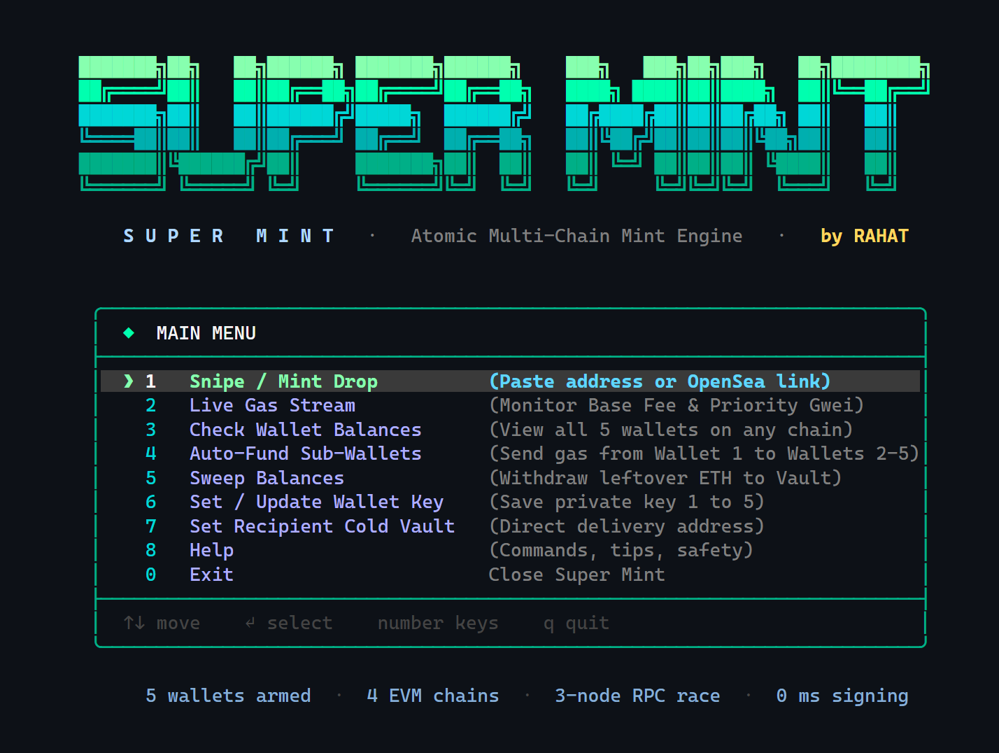

<p align="center">
  
</p>

<p align="center">
  <b>High-frequency, multi-chain NFT mint sniper</b><br>
  <sub>5 wallets · 4 chains · pre-signed bursts · live drop countdown · wallet eligibility</sub>
</p>

# SUPER MINT — Multi-Chain Ultra-Fast NFT Mint Sniper

[](https://opensource.org/licenses/MIT)
[](https://nodejs.org/)
[](https://opensea.io)
[]()
[]()

High-frequency, institutional-grade automated minting suite engineered to execute sub-second transactions on OpenSea SeaDrop V1 contracts and generic Web3 smart contracts. Designed to outperform conventional minting scripts through in-memory cryptographic pre-signing, multi-RPC racing, and atomic countdown synchronization.

Built and maintained by **RAHAT**.

---

## Table of Contents
1. [Architectural Overview & Competitive Edge](#architectural-overview--competitive-edge)
2. [Supported Networks](#supported-networks)
3. [Prerequisites & System Requirements](#prerequisites--system-requirements)
4. [Installation & Setup](#installation--setup)
5. [Wallet Configuration (5-Wallet Modular Architecture)](#wallet-configuration-5-wallet-modular-architecture)
6. [Detailed Command Reference](#detailed-command-reference)
   - [1. Wallet Key Management (`set-wallet`)](#1-wallet-key-management-set-wallet)
   - [2. Multi-Chain Balance Query (`wallets`)](#2-multi-chain-balance-query-wallets)
   - [3. Real-Time Network Gas & Gwei Tracker (`gas`)](#3-real-time-network-gas--gwei-tracker-gas)
   - [4. Contract & Drop Inspection (`inspect`)](#4-contract--drop-inspection-inspect)
   - [5. Atomic Sniper Execution (`snipe`)](#5-atomic-sniper-execution-snipe)
7. [Mint Capacity & Quantity Handling](#mint-capacity--quantity-handling)
8. [High-Performance VPS Deployment Guide (Sub-5ms Latency)](#high-performance-vps-deployment-guide-sub-5ms-latency)
9. [Safety Interlocks & Risk Controls](#safety-interlocks--risk-controls)
10. [Troubleshooting & Error Codes](#troubleshooting--error-codes)
11. [Security Principles](#security-principles)
12. [License & Disclaimer](#license--disclaimer)

---

## Architectural Overview & Competitive Edge

Conventional minting bots and browser extensions typically fail during competitive public drops for three structural reasons:
1. **Cryptographic Signing Delay:** Standard tools wait until the block timestamp opens before assembling and signing the transaction, which introduces a 200ms–500ms cryptographic CPU bottleneck.
2. **Single-RPC Chokepoints:** Sending transactions to a single RPC node exposes the caller to dropped packets, rate-limiting, and network propagation delays.
3. **Mempool Latency:** Submitting after the block opens guarantees placement in subsequent blocks or behind competitive MEV/searcher transactions.

### How OpenSea Ultra Sniper Solves This:
```
+-----------------------------------------------------------------------------------+
|                         COUNTDOWN PHASE (T - 60s to T - 2s)                       |
|  - Fetch live drop schedule & contract bytecode                                   |
|  - Pre-encode transaction payload (SeaDrop ABI or custom mint signature)          |
|  - Cryptographically PRE-SIGN raw hex transactions in memory for all 5 wallets   |
|  - Stream live Base Fee & calculate 25% priority gas tip                          |
+-----------------------------------------------------------------------------------+
                                          |
                                          v
+-----------------------------------------------------------------------------------+
|                           SAFETY INTERLOCK (T - 2s)                               |
|  - Verify live contract price has not mutated                                     |
|  - Verify drop schedule start time has not been delayed                           |
|  - Abort instantly if adverse modification detected                               |
+-----------------------------------------------------------------------------------+
                                          |
                                          v
+-----------------------------------------------------------------------------------+
|                         ATOMIC PRE-FIRE BUFFER (T - 50ms)                         |
|  - 15ms high-frequency polling loop reaches 50ms trigger buffer                   |
|  - Multi-Node Broadcaster blasts signed payloads simultaneously to 3-4 RPCs       |
|  - First responding RPC commits payload to mempool -> Top-of-Block Inclusion      |
+-----------------------------------------------------------------------------------+
```

---

## Supported Networks

The suite natively supports the following EVM networks with pre-configured high-throughput RPC endpoints:

| Network | Chain ID | Native Currency | SeaDrop V1 Address | Supported Protocol |
| :--- | :---: | :---: | :---: | :--- |
| **Ethereum Mainnet** | `1` | ETH | `0x00005EA00Ac477B1030CE78506496665451e930B` | SeaDrop V1 / Custom Contracts |
| **Base Mainnet** | `8453` | ETH | `0x00005EA00Ac477B1030CE78506496665451e930B` | SeaDrop V1 / Custom Contracts |
| **Robinhood Chain** | `48` | ETH | `0x00005EA00Ac477B1030CE78506496665451e930B` | SeaDrop V1 / Custom Contracts |
| **Ink Chain** | `57073` | ETH | `0x00005EA00Ac477B1030CE78506496665451e930B` | SeaDrop V1 / Custom Contracts |

---

## Prerequisites & System Requirements

- **Operating System:** Linux (Ubuntu 20.04+, Debian 11+ recommended for VPS), macOS, or Windows 10/11.
- **Node.js Environment:** Version `18.0.0` or higher (`node -v`).
- **Package Manager:** `npm` (included with Node.js) or `yarn`.
- **Git:** Version `2.30+` installed.

---

## Installation & Setup

### 🪟 Windows Setup Guide (PC / Laptop)

#### 🚀 1-Click Zero-Touch Auto Installer (Recommended for Everyone)
No coding, no manual installs, no error troubleshooting!
1. **[Click here to Download ZIP](https://github.com/OSINTrahat/opensea-ultra-sniper/archive/refs/heads/main.zip)** and extract the folder.
2. Double-click **`setup.bat`**
   - *It automatically unblocks PowerShell permissions.*
   - *It automatically checks and installs Git if missing.*
   - *It automatically checks and installs Node.js if missing.*
   - *It installs all bot packages and launches the bot automatically!*
3. Afterwards, simply double-click **`run.bat`** (or type `sniper`) anytime to start!

---

#### ⚡ Fast 1-Command Setup (For Terminal Users)
Open **Command Prompt (CMD)** and paste this single line:
```cmd
git clone https://github.com/OSINTrahat/opensea-ultra-sniper.git && cd opensea-ultra-sniper && npm install && npm link && sniper
```

---

### 📱 Android Phone Setup Guide (Termux)

Run the bot directly on your Android phone with zero latency.

#### Step 1: Install Termux
Install **Termux** from [F-Droid](https://f-droid.org/en/packages/com.termux/) *(Do not use Google Play Store version)*.

#### Step 2: 1-Line Copy & Paste Setup
Open Termux and paste this single command:
```bash
pkg update -y && pkg install -y nodejs git && git clone https://github.com/OSINTrahat/opensea-ultra-sniper.git && cd opensea-ultra-sniper && npm install && npm link && sniper
```

#### Step 3: Launch Anytime
Whenever you open Termux in the future, just type:
```bash
sniper
```
The clean interactive menu will open on your phone screen! You can pick options simply by pressing `1`, `2`, `3` etc.

---

### ⚡ Interactive Mode (No Complicated Commands)
You do **not** need to remember long commands. Just run:
```bash
sniper
```
The branded **SUPER MINT** opening page appears, and every action is one keypress away:

```text
   ███████╗██╗   ██╗██████╗ ███████╗██████╗    ███╗   ███╗██╗███╗   ██╗████████╗
   ██╔════╝██║   ██║██╔══██╗██╔════╝██╔══██╗   ████╗ ████║██║████╗  ██║╚══██╔══╝
   ███████╗██║   ██║██████╔╝█████╗  ██████╔╝   ██╔████╔██║██║██╔██╗ ██║   ██║
   ╚════██║██║   ██║██╔═══╝ ██╔══╝  ██╔══██╗   ██║╚██╔╝██║██║██║╚██╗██║   ██║
   ███████║╚██████╔╝██║     ███████╗██║  ██║   ██║ ╚═╝ ██║██║██║ ╚████║   ██║
   ╚══════╝ ╚═════╝ ╚═╝     ╚══════╝╚═╝  ╚═╝   ╚═╝     ╚═╝╚═╝╚═╝  ╚═══╝   ╚═╝

              S U P E R   M I N T   ·   Atomic Multi-Chain Mint Engine   ·   by RAHAT

  ╭──────────────────────────────────────────────────────────────────────────╮
  │  ◆  MAIN MENU                                                            │
  ├──────────────────────────────────────────────────────────────────────────┤
  │    ❯ 1   Snipe / Mint Drop       (Paste address or OpenSea link)        │
  │      2   Live Gas Stream         (Monitor Base Fee & Priority Gwei)      │
  │      3   Check Wallet Balances   (View all 5 wallets on any chain)       │
  │      4   Auto-Fund Sub-Wallets   (Send gas from Wallet 1 to Wallets 2-5) │
  │      5   Sweep Balances          (Withdraw leftover ETH to Vault)        │
  │      6   Set / Update Wallet Key (Save private key 1 to 5)               │
  │      7   Set Recipient Vault     (Direct delivery address)               │
  │      8   Help                    (Commands, tips, safety)                │
  │      0   Exit                    (Close Super Mint)                      │
  ├──────────────────────────────────────────────────────────────────────────┤
  │  ↑↓ move    ↵ select    number keys    q quit                           │
  ╰──────────────────────────────────────────────────────────────────────────╯
```
*(Illustrative sample — colours are mint/teal on your terminal.)*

**Three ways to pick, whichever feels natural:**
- **Arrow keys:** `↑` / `↓` to move the green pointer, `Enter` to confirm.
- **Number keys:** press `1`–`8` (or `0` to exit) and it selects instantly.
- **Vim keys:** `j` / `k` move, `q` quits.

Every sub-screen (network picker, speed tier, wallet slot) uses the same arrow-key picker, so there is nothing to type except the contract and quantities.

**Contract input:** when it asks for the contract, paste either the raw `0x…` address or an OpenSea / Basescan / mint-page link — the bot extracts the address and, when the link contains one, switches to that chain automatically.

#### What the snipe flow shows before you mint

```text
  DROP INFO | BASE
  Contract        0x889c162A52277d332F09025eB0E63b36E08f9064
  Network         BASE (Chain ID: 8453)
  Protocol        OpenSea SeaDrop (0x00005EA00Ac477B1030CE78506496e8C2dE24bf5)
  Live Gas        0.008 Gwei (~0.000002 ETH)

  MINT PHASES & COUNTDOWN
  Phase                       Price        Starts                   Time Left    Max  Status
  #1 Allowlist / GTD / FCFS   0.0005 ETH   11/11/2026, 9:00:00 PM   ended        2    ENDED
  #2 Public Mint              0.0008 ETH   11/11/2026, 10:30:00 PM  in 15m 0s    3    UPCOMING

  info  Next: Public Mint opens in 15m 0s (11/11/2026, 10:30:00 PM).

  WALLET ELIGIBILITY
  #  Wallet              Address       Phase        Needed        Balance       Verdict
  1  Wallet 1 (Master)   0x71C7…976F   Public Mint  0.00080 ETH   0.01230 ETH   ✓ ELIGIBLE
  2  Wallet 2            0x2546…Ec30   Public Mint  0.00080 ETH   0.00040 ETH   LOW FUNDS
  3  Wallet 3            0xbDA5…197E   Public Mint  0.00080 ETH   0.02000 ETH   LIMIT HIT
  4  Wallet 4            —             Public Mint  0.00080 ETH   —             NO KEY
```
*(Illustrative sample.)*

Verdicts are computed live: `ELIGIBLE` (key + enough balance for price and gas), `LOW FUNDS`, `LIMIT HIT` (wallet already minted its max), `NO KEY`, `NOT SET`.

#### Choosing who mints

Right after the info screen you get:

| Option | What happens |
|---|---|
| `1) Single wallet` | pick one slot (1–5) from your configured wallets |
| `2) Multi parallel` | type the slots, e.g. `1 2 4 5` or `all` — those fire together |
| `0) Cancel` | back to the menu |

Slots without a key are skipped with a warning, and the chosen wallets are echoed before arming.

---

## Wallet Configuration (5-Wallet Modular Architecture)

The system supports up to **5 independent wallets** stored locally in `wallets.json`.
> **Security Notice:** `wallets.json` is strictly ignored by `.gitignore` and is never committed to GitHub.

Configure your wallets using the command line:

```bash
# Configure Wallet 1
sniper set-wallet 1 0xYOUR_PRIVATE_KEY_1

# Configure Wallet 2
sniper set-wallet 2 0xYOUR_PRIVATE_KEY_2

# Configure Wallet 3
sniper set-wallet 3 0xYOUR_PRIVATE_KEY_3

# Configure Wallet 4
sniper set-wallet 4 0xYOUR_PRIVATE_KEY_4

# Configure Wallet 5
sniper set-wallet 5 0xYOUR_PRIVATE_KEY_5
```

---

## Detailed Command Reference

### 1. Wallet Key Management (`set-wallet`)
Stores or updates the private key for an allocated wallet slot (1 through 5). Automatically derives and prints the public checksum address.

```bash
sniper set-wallet <walletId: 1-5> <privateKey>
```
**Example:**
```bash
sniper set-wallet 1 0x4f3edf983ac636a65a842ce7c78d5aa706d41cdc168f8364ff0d58a975183388
```
**Output:**
```
[OK] Wallet 1 successfully configured -> Address: 0x90F8bf6A479f320ead074411a4B0e7944Ea8c9C1
```

---

### 2. Recipient Vault & Auto-Forwarding (`recipient`)
Configures a primary destination address. All NFTs minted across your sub-wallets will be minted or delivered directly into this vault address, eliminating the need to hold valuable NFTs across temporary sub-wallets.

```bash
# View current recipient vault
sniper recipient

# Set new recipient vault address
sniper recipient 0xYourMainColdVaultAddress
```

---

### 3. One-Click Sub-Wallet Gas Dispatcher (`fund`)
Automatically funds Wallets 2 through 5 from Wallet 1 (Master Wallet) in a single command. You only ever need to send ETH to Wallet 1; the bot will disburse exact mint + gas funds to the other wallets automatically.

```bash
sniper fund <amountInEth> [chain]
```
**Example:**
```bash
sniper fund 0.005 base
```

---

### 4. Post-Mint Sweeper / Withdraw (`sweep`)
Sweeps all leftover native ETH from sub-wallets (Wallets 2-5) back to your Master Wallet or Recipient Vault after the mint has concluded, deducting only the minimal transfer gas.

```bash
sniper sweep [chain]
# or: sniper withdraw [chain]
```
**Example:**
```bash
sniper sweep base
```

---

### 5. Multi-Chain Balance Query (`wallets`)
Queries real-time native ETH balances across all 5 wallets on the specified chain.

```bash
sniper wallets [chain: ethereum | base | robinhood | ink]
```
*(Default chain: `base`)*

**Example:**
```bash
sniper wallets base
```
**Output Table:**
```
┌─────────┬────────────┬────────────────────────────────────────────┬─────────────┬────────┐
│ ID      │ Name       │ Address                                    │ Balance     │ Status │
├─────────┼────────────┼────────────────────────────────────────────┼─────────────┼────────┤
│ 1       │ Wallet 1   │ 0x90F8bf6A479f320ead074411a4B0e7944Ea8c9C1 │ 0.04500 ETH │ ACTIVE │
│ 2       │ Wallet 2   │ 0xFFcf8FDEE72ac11b5c542428B35EEF5769C409f0 │ 0.02100 ETH │ ACTIVE │
│ 3       │ Wallet 3   │ 0x22d491Bde2303f2f13385b1E34952F2285b24471 │ 0.01500 ETH │ ACTIVE │
│ 4       │ Wallet 4   │ Not configured                             │ 0.00000 ETH │ INACTIVE│
│ 5       │ Wallet 5   │ Not configured                             │ 0.00000 ETH │ INACTIVE│
└─────────┴────────────┴────────────────────────────────────────────┴─────────────┴────────┘
```

---

### 3. Real-Time Network Gas & Gwei Tracker (`gas`)
Streams live network Base Fee, Priority Fee, and estimated gas cost per mint. Automatically polls every 2.5 seconds with zero-lag RPC failover.

```bash
sniper gas [chain: ethereum | base | robinhood | ink]
```

**Example:**
```bash
sniper gas base
```
**Output Stream:**
```
[INFO] Streaming network gas updates for BASE (Press Ctrl+C to terminate)...
[12:04:15 AM] Base: 0.011 Gwei | Priority: 0.005 Gwei | Est. Mint Gas: ~0.000002 ETH
[12:04:17 AM] Base: 0.011 Gwei | Priority: 0.005 Gwei | Est. Mint Gas: ~0.000002 ETH
[12:04:20 AM] Base: 0.012 Gwei | Priority: 0.006 Gwei | Est. Mint Gas: ~0.000002 ETH
```

---

### 4. Contract & Drop Inspection (`inspect`)
Read-only: never signs, never spends. Same info screen the snipe flow shows first — phases with countdown, per-wallet eligibility, prices, gas — but it returns straight to the shell. Use it when you only want to check a drop, or in scripts.
- **For OpenSea SeaDrop:** parses **every scheduled drop phase** (GTD Allowlist, FCFS, Public), prices, start/end times, time left, wallet mint stats, and wallet eligibility.
- **For Custom Web3 Contracts:** analyzes bytecode to detect standard mint signatures (`mint()`, `claim()`, `publicMint(uint256)`), checks paused state, and reports pricing.

```bash
sniper inspect <contractAddress | link> [chain]
```

**Example:**
```bash
sniper inspect https://opensea.io/collection/boredapeyachtclub
sniper inspect 0x1234567890abcdef1234567890abcdef12345678 base
```

**Output:**
```
  DROP INFO | ETHEREUM
  ------------------------------------------------------
  Contract        0xBC4CA0EdA7647A8aB7C2061c2E118A18a936f13D
  Network         ETHEREUM (Chain ID: 1)
  Protocol        Generic ERC-721 mint
  Live Gas        0.066 Gwei (~0.000012 ETH)

  MINT SCHEDULE
  ------------------------------------------------------
  Type            Generic Web3 / Custom Mint
  Functions       Fallback mint() supported
  Price           0 ETH
  Status          OPEN

  WALLET ELIGIBILITY
  ------------------------------------------------------
  #    Wallet               Address      Phase      Needed         Balance       Verdict
  -------------------------------------------------------------------------------------
  1    Wallet 1 (Master)    0x71C7…976F  Public     0.00001 ETH    0.01230 ETH   ✓ ELIGIBLE
  2    Wallet 2             0x2546…Ec30  Public     0.00001 ETH    0.00000 ETH   LOW FUNDS
  3    Wallet 3             —            Public     0.00001 ETH    —             NO KEY
```
*(Illustrative sample. SeaDrop drops additionally show a `MINT PHASES & COUNTDOWN` table with `Time Left`.)*

---

### 5. Atomic Sniper Execution (`snipe`)
Arms pre-signed transactions, tracks live gas continuously during countdown, and fires at the 50ms pre-fire buffer across all configured RPC nodes.

**Input accepts either a raw contract address *or* a link.** Paste what you have; the bot extracts the contract and detects the chain:

| You paste | What happens |
|---|---|
| `0xBC4CA0EdA7647A8aB7C2061c2E118A18a936f13D` | used directly, you pick the chain |
| `https://opensea.io/assets/base/0x…/123` | contract + `base` detected automatically |
| `https://opensea.io/collection/boredapeyachtclub` | contract read from the collection page |
| `https://basescan.org/address/0x…` | contract + `base` detected |
| `https://zora.co/collect/base:0x…` | contract + `base` detected |

If a page hides its contract (rare), the bot says so and asks for the `0x…` address instead.

#### Mode A: 5-Wallet Parallel Burst (Recommended)
Blasts transactions simultaneously across all configured wallets.
```bash
sniper snipe <contractAddress | link> <chain> all
```
**Example:**
```bash
sniper snipe 0x1234567890abcdef1234567890abcdef12345678 base all
sniper snipe https://opensea.io/assets/base/0x889c162A52277d332F09025eB0E63b36E08f9064/1
```

#### Mode B: Single Target Wallet
Executes the snipe using only a specific wallet slot (e.g. Wallet 1).
```bash
sniper snipe <contractAddress | link> <chain> 1
```

#### Mode C: Custom Wallet Set
Comma or space separated slots, fired in parallel:
```bash
sniper snipe <contractAddress | link> base 1,2,4
```

**Execution Flow Output:**
```
[INFO] Configured 3 active wallet(s) for simultaneous parallel blast.
[GAS] Network Gas: 0.011 Gwei | Est Fee: ~0.000002 ETH
[INFO] Inspecting target contract on BASE...
[INFO] Arming and pre-signed raw transactions...
[ARMED] Target Contract: 0x1234567890abcdef1234567890abcdef12345678
[ARMED] Locked Price: 0.000 ETH
[ARMED] Scheduled Time: 11/11/2026, 12:30:00 AM
[INFO] Sniper engine armed. Active Wallets: 3

[COUNTDOWN] 4.2s remaining | Live Gas: [0.011 Gwei]
[COUNTDOWN] 1.1s remaining | Live Gas: [0.012 Gwei]

[TRIGGER] Blasting 3 transaction(s) across multi-node RPCs...
[OK] [Wallet 1] Accepted in 42ms | Hash: 0x93b7482618ec...
[OK] [Wallet 2] Accepted in 45ms | Hash: 0x29ef90a182b3...
[OK] [Wallet 3] Accepted in 48ms | Hash: 0x55aa029cd410...

======================== SNIPE EXECUTION RESULTS ========================
┌─────────┬──────────┬────────────────────────────────────────────────────────────────────┬───────────┐
│ Success │ Wallet   │ Hash                                                               │ Latency   │
├─────────┼──────────┼────────────────────────────────────────────────────────────────────┼───────────┤
│ true    │ Wallet 1 │ 0x93b7482618ecbf542c385fa8145719ab23c4a259c73ef8902d847183efba098 │ 42ms      │
│ true    │ Wallet 2 │ 0x29ef90a182b3dc182746f39185a73b4009f48ca179475185938bf82384a838  │ 45ms      │
│ true    │ Wallet 3 │ 0x55aa029cd4108849b287582b185938a18357492c10958371948572837109b8  │ 48ms      │
└─────────┴──────────┴────────────────────────────────────────────────────────────────────┴───────────┘
```

---

## Mint Capacity & Quantity Handling

### How many NFTs can be minted?
1. **Quantity Per Transaction:**
   - The engine defaults to minting `1` token per wallet to minimize execution failure risk from contract caps.
   - For contracts with higher allowances (e.g. 2, 5, or 10 per wallet), you can adjust the quantity parameter directly in `snipe_engine.js`.
2. **Parallel Wallet Multiplier:**
   - By enabling all 5 wallets (`all`), the bot multiplies your total allocation:
     $$\text{Total Minted} = 5 \times (\text{Quantity per Wallet})$$
   - E.g., if a drop allows 2 NFTs per wallet, running 5 wallets will capture **10 NFTs** in the exact same block.
3. **Contract Restrictions (`maxTotalMintableByWallet`):**
   - The `inspect` command automatically queries `getMintStats()` to determine if any of your configured wallets have already minted part of their quota.

---

## High-Performance VPS Deployment Guide (Sub-5ms Latency)

For the fastest possible execution, run this suite on a cloud VPS located close to major Web3 node providers (e.g. Frankfurt, London, or Virginia):

### Quick VPS Setup (Ubuntu/Debian):
```bash
# 1. Update system packages
sudo apt update && sudo apt install -y git curl

# 2. Install Node.js 18+
curl -fsSL https://deb.nodesource.com/setup_18.x | sudo -E bash -
sudo apt install -y nodejs

# 3. Clone repository
git clone https://github.com/OSINTrahat/opensea-ultra-sniper.git
cd opensea-ultra-sniper
npm install

# 4. Set your wallets
sniper set-wallet 1 <PRIVATE_KEY>

# 5. Run under TMUX or SCREEN (keeps session alive if SSH disconnects)
tmux new -s sniper
sniper snipe <CONTRACT_ADDRESS> base all
# Detach with: Ctrl+B then D
```

---

## Safety Interlocks & Risk Controls

To protect users against common on-chain exploits and ninja changes by project owners, the engine implements automated guards:

1. **Price Modification Guard:**
   - Exactly 2 seconds before drop opening, the bot queries the on-chain contract. If the price in the contract differs from the pre-signed price, the bot immediately aborts execution.
2. **Schedule Mutation Guard:**
   - If project administrators postpone or advance the drop start time while the countdown is running, execution aborts to prevent wasting gas fees on reverted calls.
3. **Nonce Conflict Mitigation:**
   - When arming transactions, pending nonces are fetched with priority to avoid replacement transaction stalls.

---

## Troubleshooting & Error Codes

| Error Message | Cause | Resolution |
| :--- | :--- | :--- |
| `SAFETY_ABORT: Price modified...` | Contract owner altered mint price before launch. | Run `inspect` to check new price; re-arm if acceptable. |
| `INSUFFICIENT_FUNDS` | Wallet balance is lower than mint price + priority gas tip. | Fund wallet with native ETH on the target chain. |
| `All RPC nodes failed for chain...` | Temporary DNS or public RPC network rate-limit. | Add custom private RPCs (Alchemy, Infura, QuickNode) in `sniper_config.js`. |
| `Address is not a deployed contract` | Incorrect address or wrong chain selected. | Verify the contract address and network parameter (e.g., `base`, `ink`, `ethereum`). |

---

## Security Principles

- **No Remote Telemetry:** The bot does not transmit private keys, balances, or configuration data to any external server. All communication occurs strictly between your machine and official blockchain RPC nodes.
- **Git Exclusions:** `wallets.json` is hard-coded into `.gitignore`. Never use `git add -f wallets.json`.
- **Dedicated Sniper Wallets:** Always use dedicated burner or sub-wallets with only the necessary ETH balance required for the specific mint. Never store primary holding vaults on automated trading servers.

---

## License

This project is licensed under the [MIT License](LICENSE).

---

## Disclaimer

This software is provided for educational and automated testing purposes. Blockchain transactions are irreversible and gas fees are non-refundable. Always verify contract addresses, mint prices, and network conditions before executing transactions. The developers assume no liability for financial loss resulting from on-chain execution.
